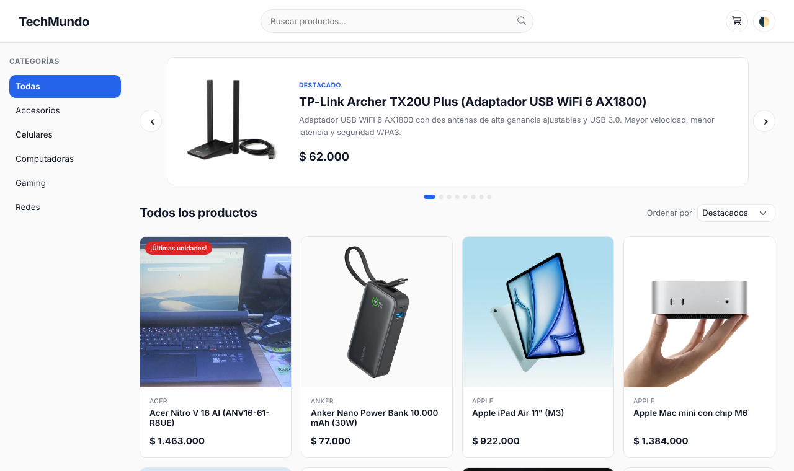
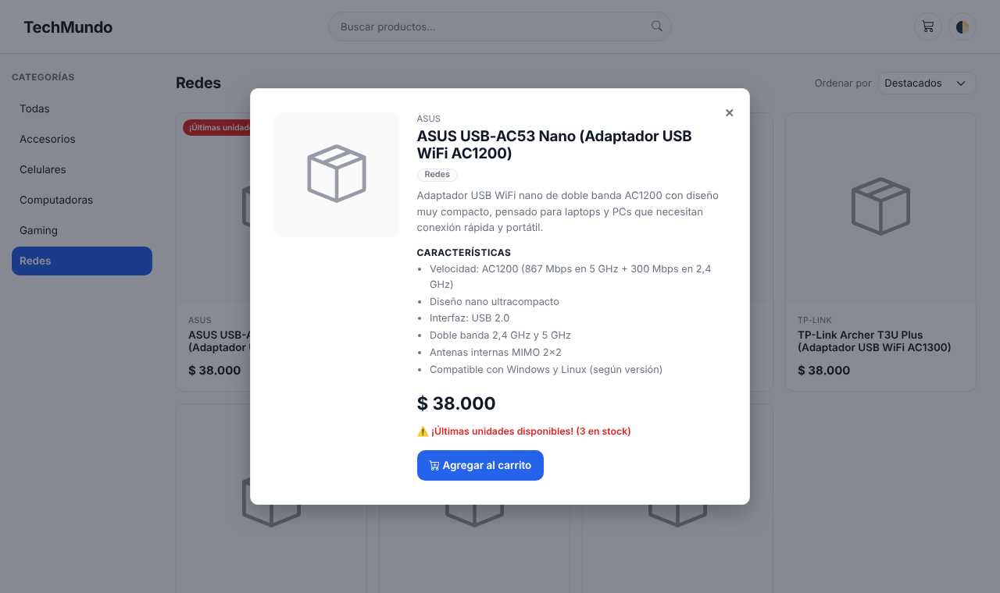
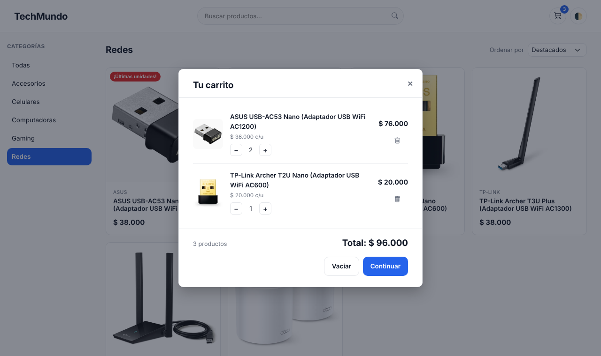
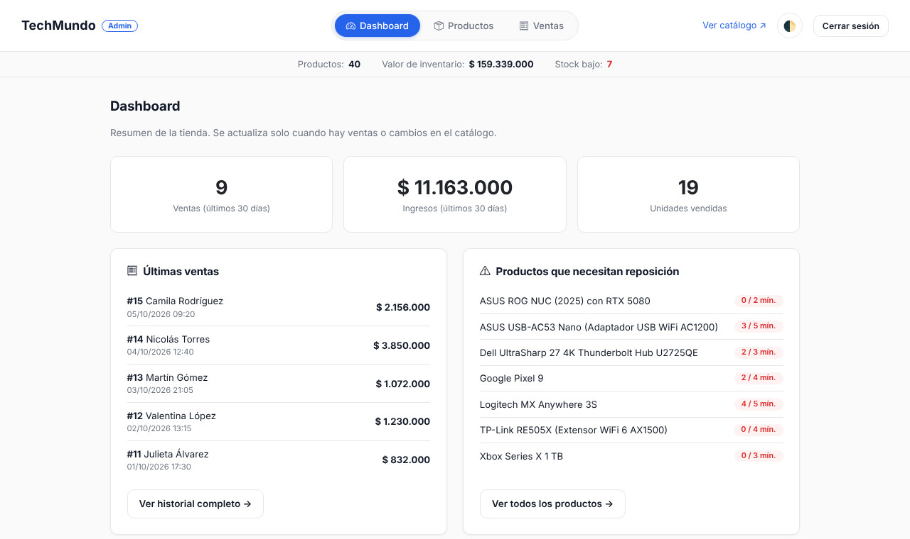
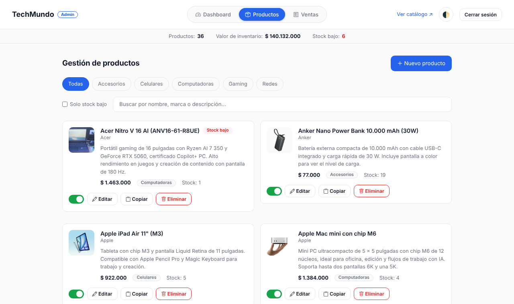
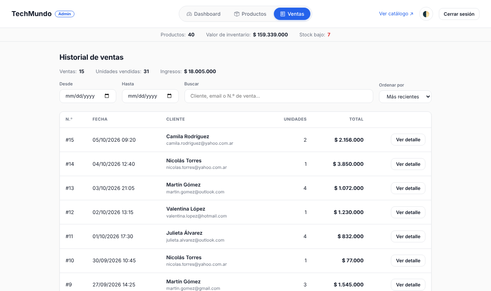
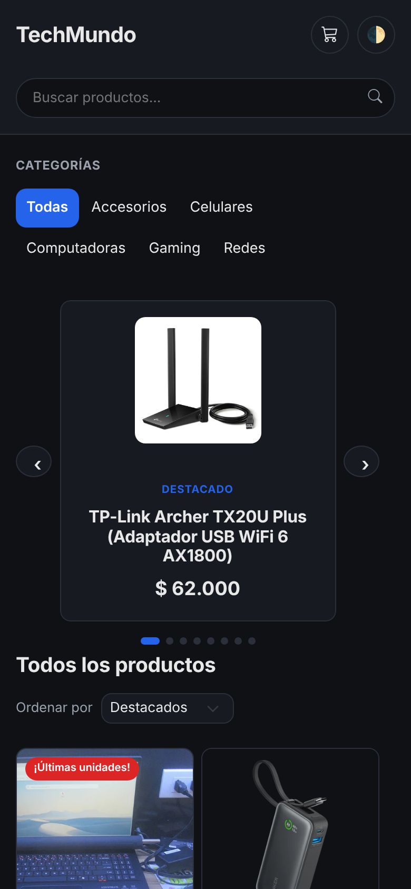
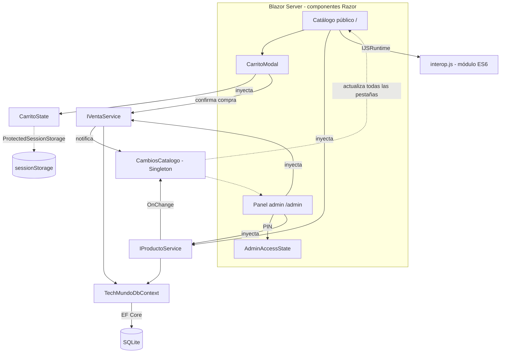

# TechMundo — Tienda de tecnología en Blazor


Proyecto Integrador de la materia **Desarrollo Web con Blazor** (Tecnicatura Superior en
Análisis, Desarrollo y Programación de Aplicaciones — ISFT N.º 93). TechMundo es una
tienda de tecnología (computadoras, celulares, accesorios, gaming y redes) con dos frentes:
un **catálogo público con carrito de compras** para clientes y un **panel de administración**
para gestionar el inventario y ver el historial de ventas.

> Los precios del catálogo están en **pesos argentinos (ARS)**: precios de lista en dólares convertidos
> al dólar oficial BNA de octubre de 2026 ($1.540) y redondeados a los $1.000. Son aproximados y pueden
> diferir de los precios de venta reales en Argentina (impuestos de importación, etc.).

## Capturas

| Catálogo | Detalle del producto |
|---|---|
|  |  |
| **Carrito** | **Dashboard del admin** |
|  |  |
| **Gestión de productos** | **Historial de ventas** |
|  |  |



> Las capturas se tomaron en un entorno sin acceso a los sitios de las imágenes de los productos, por eso
> se ve el ícono por defecto. En la app real, los 29 productos que tienen una URL de imagen cargada muestran su foto.

## Stack tecnológico

- **Frontend:** Blazor Server (.NET 8, modo interactivo sin prerender), CSS Isolation, JS Interop (módulo ES6), Bootstrap 5 + Bootstrap Icons
- **Backend/Datos:** Entity Framework Core 8, SQLite, `DbContextFactory`
- **Validaciones:** Data Annotations + validación cruzada (`IValidatableObject`) + concurrencia optimista (`[ConcurrencyCheck]`)
- **CI/CD:** GitHub Actions → Azure App Service

## Arquitectura



## Estructura del proyecto

```
TechMundo/
├── Models/       Producto, Categoria, Venta, VentaItem, PagedResult, OrdenProducto
├── Data/         TechMundoDbContext (relaciones, seed: 5 categorías, 40 productos, 15 ventas)
├── Services/     IProductoService, IVentaService, CarritoState, AdminAccessState, CambiosCatalogo
├── Shared/       CatalogoLayout, AdminLayout, LayoutMinimo (página de error), Formato
├── Components/   Modal, ImagenProducto, ProductoVidriera, ProductoCarrusel, ProductoModal,
│                 CarritoModal, ProductoCard, ProductoForm, ConfirmDialog, VentaDetalleModal,
│                 EstadisticaCard, Paginacion, AlertError
├── Pages/
│   ├── Catalogo/Index.razor   "/" y "/categoria/{cat}" — catálogo público
│   ├── Admin/                 Dashboard, Productos, Nuevo/Editar producto, Ventas
│   └── Error.razor            Página de error de producción
├── Properties/   launchSettings.json (perfiles http/https en Development)
├── wwwroot/      css/app.css (tema), js/interop.js (JS Interop), lib/ (Bootstrap e íconos locales)
├── docs/         Historias de usuario, Git Flow, despliegue, defensa, matriz de requisitos, capturas
└── .github/      Workflow de CI/CD y plantillas de issues y Pull Requests
```

## Funcionalidades

**Catálogo público** (`/`)
- Carrusel de destacados con autoplay (100% Blazor/CSS, sin JS) y categorías en la barra lateral
- Búsqueda por nombre, marca o descripción (`LIKE`, sin distinguir mayúsculas) y "Ordenar por" precio
- Detalle del producto en un modal con características, stock y botón "Agregar al carrito"
- **Carrito** en una ventana modal: valida el stock al agregar, cambia cantidades, muestra el total y
  se conserva al recargar la página (F5)
- **Compra**: pide nombre y email (validados), vuelve a validar el stock contra la base, lo descuenta
  y registra la venta en una transacción

**Panel de administración** (`/admin`)
- Dashboard con ventas e ingresos de los últimos 30 días, últimas ventas y alertas de stock bajo
  (notificación del navegador vía JS Interop)
- CRUD de productos con validación, toggle de disponibilidad, borrado con confirmación y filtros
- **Historial de ventas** paginado, con filtros por fecha, búsqueda por cliente/N.º y orden, resumen
  de ingresos y detalle de cada venta
- Las estadísticas y el historial se actualizan solos cuando hay una venta en otra pestaña

**Calidad**
- Errores visibles en la interfaz (`ErrorBoundary`, `AlertError`, página `/Error`), sin "pantalla de muerte"
- Concurrencia optimista: si una venta modifica un producto mientras el admin lo edita, el guardado se
  rechaza con un aviso en lugar de pisar el stock
- Modales accesibles (cierre con Escape, foco automático) y tarjetas operables con teclado
- Modo oscuro persistente, diseño responsive mobile-first (probado a 375 px)
- Bootstrap e íconos servidos desde `wwwroot/lib`: la app no depende de un CDN externo

## Instalación

Requisitos: [.NET 8 SDK](https://dotnet.microsoft.com/download/dotnet/8.0).

```bash
git clone https://github.com/marcosh2222-m/TechMundo.git
cd TechMundo
dotnet run --launch-profile https
```

- Abre `https://localhost:7180`. El perfil de `Properties/launchSettings.json` usa el ambiente **Development**:
  base `techmundo-dev.db` y PIN de demo `2468` para `/admin`.
- La primera vez la app crea la base y carga los datos de ejemplo sola (`Database.Migrate()` en `Program.cs`);
  no hace falta correr `dotnet ef database update`.
- En Visual Studio: abrir `TechMundo.csproj` y ejecutar con el perfil **https** (F5).

### Migraciones

Las migraciones están versionadas en la carpeta `Migrations/`. Cuando cambia el modelo **no** se
borran: se agrega una migración nueva con un nombre descriptivo, por ejemplo:

```bash
dotnet tool install --global dotnet-ef        # una sola vez
dotnet ef migrations add AgregarCampoX
dotnet run --launch-profile https             # la app aplica la migración al iniciar
```

## Configuración

### PIN del panel de administración

El PIN **no está en el código ni en `appsettings.json`** (la checklist de entrega pide no publicar
credenciales). Se configura así:

| Ambiente | Cómo |
|---|---|
| Desarrollo | `dotnet user-secrets set "AdminPin" "1234"` (si no se configura nada, en Development se usa el PIN de demo `2468`) |
| Producción (Azure) | App Service → Configuración → Variables de entorno → `AdminPin` |

Si en producción no hay PIN configurado, el panel queda deshabilitado.

**Esto no es autenticación real**: no hay usuarios, roles ni contraseñas hasheadas en una base.
Incluye mitigaciones básicas (comparación en tiempo constante, bloqueo de 30 s tras 5 intentos
fallidos, sesión recordada solo en la pestaña actual), pero un sistema real necesitaría
ASP.NET Core Identity, que está fuera del alcance de la materia.

### Variables de entorno

| Variable | Descripción | Ejemplo |
|---|---|---|
| `ASPNETCORE_ENVIRONMENT` | Ambiente de ejecución | `Development` / `Production` |
| `ConnectionStrings__Default` | Cadena de conexión SQLite (la carpeta se crea sola si no existe) | `Data Source=/home/data/techmundo.db` |
| `AdminPin` | PIN de acceso al panel de admin | *(definir en Azure / User Secrets)* |

## Limitaciones conocidas

- **PIN de admin**: no es autenticación real (ver arriba).
- **Búsqueda con acentos**: `LIKE` de SQLite ignora mayúsculas solo en letras sin acento; "cámara" no
  encuentra "Cámara" (HU-17 del backlog).
- **Imágenes externas**: las fotos se cargan desde los sitios de los fabricantes; si alguno falla, se muestra
  un ícono por defecto. 11 productos no tienen foto y se pueden completar desde el panel.
- **SQLite en Azure**: adecuado para la demo (una instancia); para producción real convendría Azure SQL.

## Documentación del proyecto (Unidad 4)

| Documento | Contenido |
|---|---|
| [docs/HISTORIAS-DE-USUARIO.md](docs/HISTORIAS-DE-USUARIO.md) | Historias de usuario, criterios de aceptación, Definition of Done y Product Backlog |
| [docs/GIT-FLOW.md](docs/GIT-FLOW.md) | Ramas, Conventional Commits, primer push, Pull Requests, issues y tablero Kanban |
| [docs/DESPLIEGUE.md](docs/DESPLIEGUE.md) | Publicación en Azure App Service con GitHub Actions, paso a paso |
| [docs/DEFENSA.md](docs/DEFENSA.md) | Guion de la presentación, checklist de entrega y preguntas probables |
| [docs/REQUISITOS.md](docs/REQUISITOS.md) | Dónde se cumple cada requisito y criterio de evaluación del Proyecto Integrador |
| [CHANGELOG.md](CHANGELOG.md) | Historial de versiones (Keep a Changelog) |

Los servicios (`IProductoService`, `IVentaService`, `CarritoState`) están documentados con XML docs; el
build genera `TechMundo.xml`, que Visual Studio usa para mostrar la ayuda en IntelliSense.

## CI/CD

El workflow [`.github/workflows/deploy.yml`](.github/workflows/deploy.yml) compila y publica en cada push o
Pull Request a `main` / `develop`, y despliega en Azure App Service solo desde `main`.
Requiere el secret `AZURE_WEBAPP_PUBLISH_PROFILE` y, opcionalmente, la variable `AZURE_WEBAPP_NAME`.

## Health check

```bash
curl https://localhost:5001/health
```

## Autor

Marcos — Tecnicatura Superior en Análisis, Desarrollo y Programación de Aplicaciones, ISFT N.º 93.
