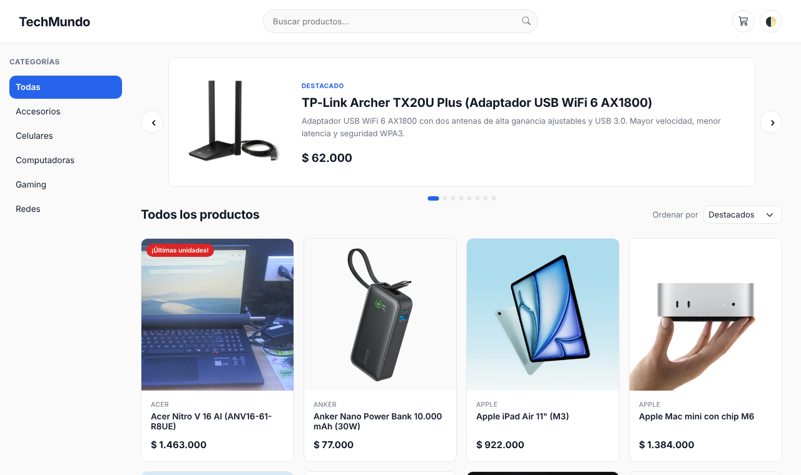
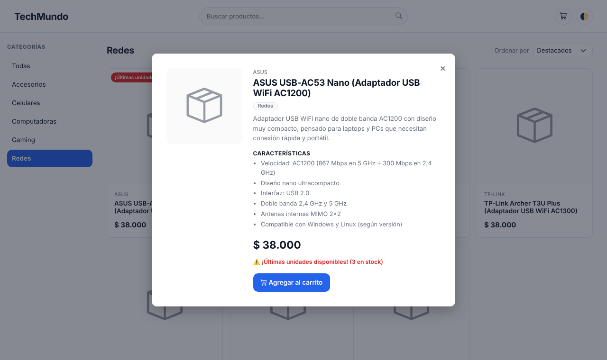
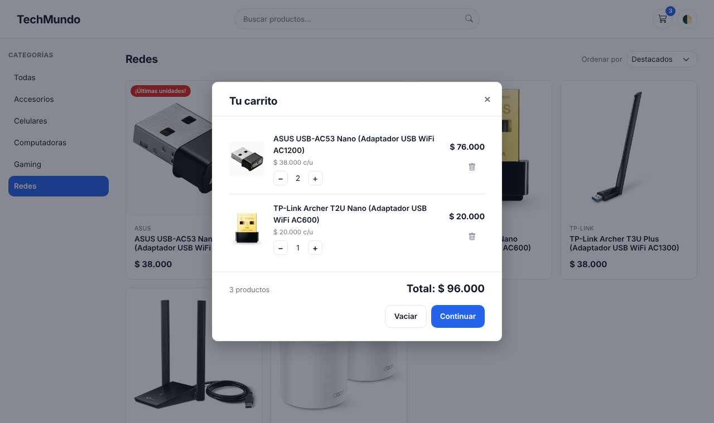
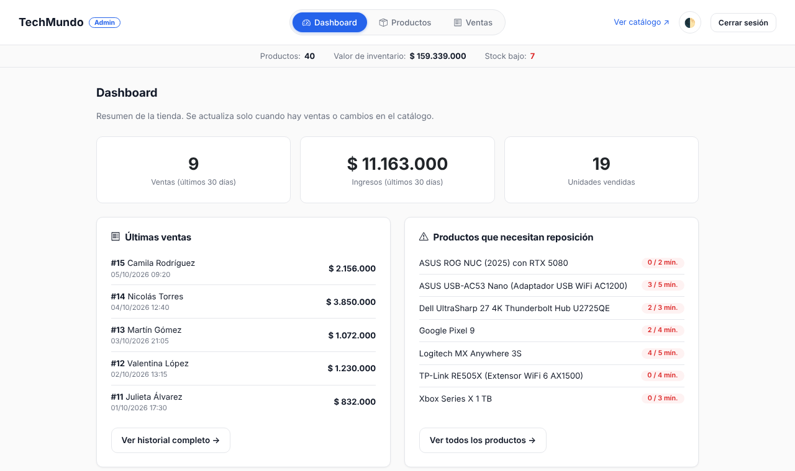
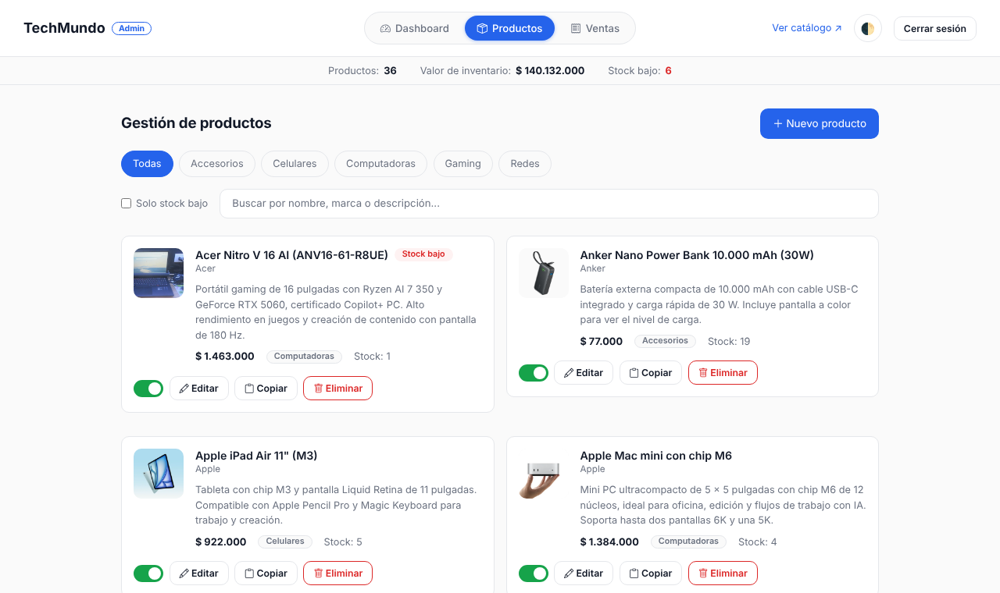
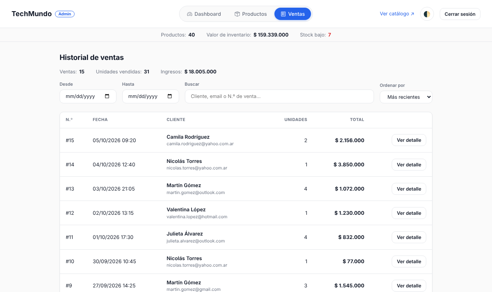
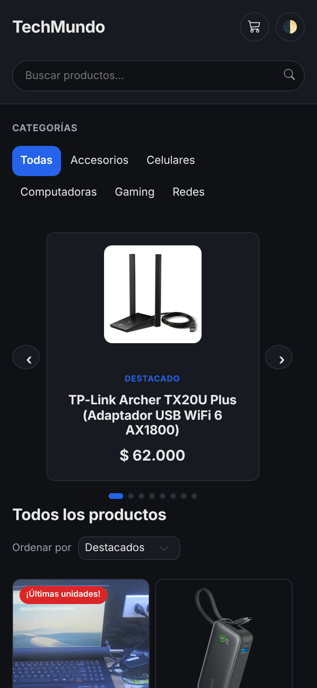
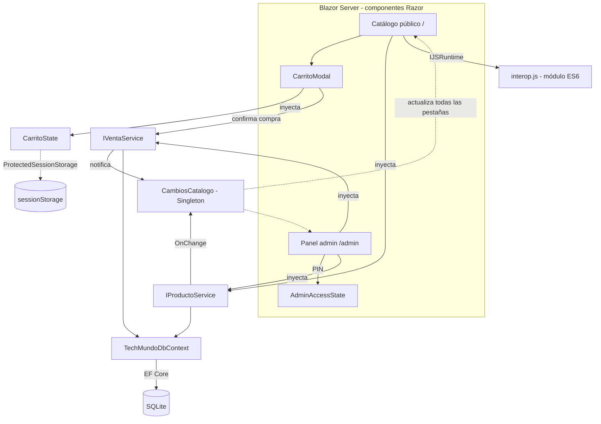

# TechMundo — Tienda de tecnología en Blazor


Proyecto Integrador de la materia **Desarrollo Web con Blazor** (Tecnicatura Superior en
Análisis, Desarrollo y Programación de Aplicaciones — ISFT N.º 93). TechMundo es una
tienda de tecnología (computadoras, celulares, accesorios, gaming y redes) con dos frentes:
un **catálogo público con carrito de compras** para clientes y un **panel de administración**
para gestionar el inventario y ver el historial de ventas.

Web: https://techmundo.onrender.com

## Capturas

| Catálogo | Detalle del producto |
|---|---|
|  |  |
| **Carrito** | **Dashboard del admin** |
|  |  |
| **Gestión de productos** | **Historial de ventas** |
|  |  |



> 37 de los 40 productos tienen foto; 3 quedan sin imagen a propósito para mostrar el ícono por defecto
> (ver [docs/CREDITOS-IMAGENES.md](docs/CREDITOS-IMAGENES.md)).

## Stack tecnológico

- **Frontend:** Blazor Server (.NET 8, modo interactivo sin prerender), CSS Isolation, JS Interop (módulo ES6), Bootstrap 5 + Bootstrap Icons
- **Backend/Datos:** Entity Framework Core 8, SQLite, `DbContextFactory`
- **Validaciones:** Data Annotations + validación cruzada (`IValidatableObject`) + concurrencia optimista (`[ConcurrencyCheck]`)
- **CI/CD:** GitHub Actions → Docker → Render (alternativa: Azure App Service)

## Arquitectura



## Estructura del proyecto

```
TechMundo/
├── Models/       Producto, Categoria, Venta, VentaItem, PagedResult, OrdenProducto
├── Data/         TechMundoDbContext (relaciones, seed: 5 categorías, 40 productos, 15 ventas)
├── Services/     IProductoService, IVentaService, CarritoState, AdminAccessState, CambiosCatalogo
├── Shared/       CatalogoLayout, AdminLayout, LayoutMinimo (página de error), Formato
├── Components/   Modal, ImagenProducto, ProductoVidriera, ProductoCarrusel, ProductoModal,
│                 CarritoModal, ProductoCard, ProductoForm, ConfirmDialog, VentaDetalleModal,
│                 EstadisticaCard, Paginacion, AlertError
├── Pages/
│   ├── Catalogo/Index.razor   "/" y "/categoria/{cat}" — catálogo público
│   ├── Admin/                 Dashboard, Productos, Nuevo/Editar producto, Ventas
│   └── Error.razor            Página de error de producción
├── Properties/   launchSettings.json (perfiles http/https en Development)
├── wwwroot/      css/app.css (tema), js/interop.js (JS Interop), lib/ (Bootstrap e íconos), img/productos/ (fotos)
├── docs/         Historias de usuario, Git Flow, despliegue, defensa, matriz de requisitos, capturas
└── .github/      Workflow de CI/CD y plantillas de issues y Pull Requests
```

## Funcionalidades

**Catálogo público** (`/`)
- Carrusel de destacados con autoplay (100% Blazor/CSS, sin JS) y categorías en la barra lateral
- Búsqueda por nombre, marca o descripción (`LIKE`, sin distinguir mayúsculas) y "Ordenar por" precio
- Detalle del producto en un modal con características, stock y botón "Agregar al carrito"
- **Carrito** en una ventana modal: valida el stock al agregar, cambia cantidades, muestra el total y
  se conserva al recargar la página (F5)
- **Compra**: pide nombre y email (validados), vuelve a validar el stock contra la base, lo descuenta
  y registra la venta en una transacción

**Panel de administración** (`/admin`)
- Dashboard con ventas e ingresos de los últimos 30 días, últimas ventas y alertas de stock bajo
  (notificación del navegador vía JS Interop)
- CRUD de productos con validación, toggle de disponibilidad, borrado con confirmación y filtros
- **Historial de ventas** paginado, con filtros por fecha, búsqueda por cliente/N.º y orden, resumen
  de ingresos y detalle de cada venta
- Las estadísticas y el historial se actualizan solos cuando hay una venta en otra pestaña

**Calidad**
- Errores visibles en la interfaz (`ErrorBoundary`, `AlertError`, página `/Error`), sin "pantalla de muerte"
- Concurrencia optimista: si una venta modifica un producto mientras el admin lo edita, el guardado se
  rechaza con un aviso en lugar de pisar el stock
- Modales accesibles (cierre con Escape, foco automático) y tarjetas operables con teclado
- Modo oscuro persistente, diseño responsive mobile-first (probado a 375 px)
- Bootstrap e íconos servidos desde `wwwroot/lib`: la app no depende de un CDN externo

## Instalación

Requisitos: [.NET 8 SDK](https://dotnet.microsoft.com/download/dotnet/8.0).

```bash
git clone https://github.com/marcosh2222-m/TechMundo.git
cd TechMundo
dotnet run --launch-profile https
```

- Abre `https://localhost:7180`. El perfil de `Properties/launchSettings.json` usa el ambiente **Development**:
  base `techmundo-dev.db` y PIN de demo `2468` para `/admin`.
- La primera vez la app crea la base y carga los datos de ejemplo sola (`Database.Migrate()` en `Program.cs`);
  no hace falta correr `dotnet ef database update`.
- En Visual Studio: abrir `TechMundo.csproj` y ejecutar con el perfil **https** (F5).

### Migraciones

Las migraciones están versionadas en la carpeta `Migrations/`. Cuando cambia el modelo **no** se
borran: se agrega una migración nueva con un nombre descriptivo, por ejemplo:

```bash
dotnet tool install --global dotnet-ef        # una sola vez
dotnet ef migrations add AgregarCampoX
dotnet run --launch-profile https             # la app aplica la migración al iniciar
```

## Configuración

### PIN del panel de administración

El PIN **no está en el código ni en `appsettings.json`** (la checklist de entrega pide no publicar
credenciales). Se configura así:

| Ambiente | Cómo |
|---|---|
| Desarrollo | `dotnet user-secrets set "AdminPin" "1234"` (si no se configura nada, en Development se usa el PIN de demo `2468`) |
| Producción (Azure) | App Service → Configuración → Variables de entorno → `AdminPin` |

Si en producción no hay PIN configurado, el panel queda deshabilitado.

**Esto no es autenticación real**: no hay usuarios, roles ni contraseñas hasheadas en una base.
Incluye mitigaciones básicas (comparación en tiempo constante, bloqueo de 30 s tras 5 intentos
fallidos, sesión recordada solo en la pestaña actual), pero un sistema real necesitaría
ASP.NET Core Identity, que está fuera del alcance de la materia.

### Variables de entorno

| Variable | Descripción | Ejemplo |
|---|---|---|
| `ASPNETCORE_ENVIRONMENT` | Ambiente de ejecución | `Development` / `Production` |
| `ConnectionStrings__Default` | Cadena de conexión SQLite (la carpeta se crea sola si no existe) | `Data Source=/app/data/techmundo.db` (Docker) |
| `AdminPin` | PIN de acceso al panel de admin | *(definir en Render / Azure / User Secrets)* |
| `ASPNETCORE_HTTP_PORTS` | Puerto HTTP dentro del contenedor | `10000` (lo fija el `Dockerfile`) |

## Limitaciones conocidas

- **PIN de admin**: no es autenticación real (ver arriba).
- **Búsqueda con acentos**: `LIKE` de SQLite ignora mayúsculas solo en letras sin acento; "cámara" no
  encuentra "Cámara" (HU-17 del backlog).
- **Imágenes**: las fotos están en `wwwroot/img/productos` (fabricantes y Wikimedia Commons, con sus créditos);
  algunas de Wikimedia muestran un modelo cercano al del catálogo. Si una URL externa cargada desde el panel
  falla, se muestra el ícono por defecto.
- **Base de datos en Render**: en el plan gratis la base SQLite vuelve a los datos de ejemplo cada vez que el
  servicio se duerme o se publica de nuevo; para producción real haría falta una base administrada (PostgreSQL / Azure SQL).

## Dónde está cada requerimiento técnico

Ruta en el código de cada requerimiento técnico del Proyecto Integrador (Unidad 4).

### Unidad 1 — Componentes, formularios, routing y estado

| Requerimiento | Ruta en el código |
|---|---|
| Mínimo 6 componentes Razor reutilizables | [`Components/`](Components) — 13 componentes: [`ProductoCard.razor`](Components/ProductoCard.razor) (`[Parameter]` + `EventCallback`), [`Modal.razor`](Components/Modal.razor) (`RenderFragment`), [`Paginacion.razor`](Components/Paginacion.razor), [`ProductoForm.razor`](Components/ProductoForm.razor), [`ConfirmDialog.razor`](Components/ConfirmDialog.razor), [`CarritoModal.razor`](Components/CarritoModal.razor), [`ProductoModal.razor`](Components/ProductoModal.razor), [`ProductoCarrusel.razor`](Components/ProductoCarrusel.razor), [`ProductoVidriera.razor`](Components/ProductoVidriera.razor), [`VentaDetalleModal.razor`](Components/VentaDetalleModal.razor), [`EstadisticaCard.razor`](Components/EstadisticaCard.razor), [`ImagenProducto.razor`](Components/ImagenProducto.razor), [`AlertError.razor`](Components/AlertError.razor) |
| Formularios con EditForm y validación avanzada | [`Components/ProductoForm.razor`](Components/ProductoForm.razor) (`EditForm` + `DataAnnotationsValidator`), [`Models/Producto.cs`](Models/Producto.cs) (`[Range]`, `[StringLength]`, `[RegularExpression]`, `IValidatableObject.Validate`), [`Models/Validaciones.cs`](Models/Validaciones.cs) (patrones y atributo `[Obligatorio]`), [`Components/CarritoModal.razor`](Components/CarritoModal.razor) (nombre y email del cliente), [`Pages/Admin/Ventas.razor`](Pages/Admin/Ventas.razor) (rango de fechas) |
| Routing con parámetros y navegación programática | [`Pages/Admin/EditarProducto.razor`](Pages/Admin/EditarProducto.razor) (`/admin/editar-producto/{Id:int}`), [`Pages/Catalogo/Index.razor`](Pages/Catalogo/Index.razor) (`/categoria/{CategoriaFiltro}`), [`Pages/Admin/Productos.razor`](Pages/Admin/Productos.razor) (`/admin/productos/{CategoriaFiltro}` y `NavigateTo`), [`Pages/Admin/NuevoProducto.razor`](Pages/Admin/NuevoProducto.razor) (`NavigateTo` al guardar) |
| State Service con notificación reactiva | [`Services/CarritoState.cs`](Services/CarritoState.cs), [`Services/AdminAccessState.cs`](Services/AdminAccessState.cs), [`Services/CambiosCatalogo.cs`](Services/CambiosCatalogo.cs) (Singleton entre pestañas); registro en [`Program.cs`](Program.cs) |

### Unidad 2 — Interfaz visual y JS Interop

| Requerimiento | Ruta en el código |
|---|---|
| HTML5 semántico en todos los layouts | [`Shared/CatalogoLayout.razor`](Shared/CatalogoLayout.razor), [`Shared/AdminLayout.razor`](Shared/AdminLayout.razor), [`Shared/LayoutMinimo.razor`](Shared/LayoutMinimo.razor) (`header`, `nav`, `aside`, `main`, `footer`, `article`) |
| CSS Isolation en al menos 3 componentes | 17 archivos `.razor.css`: 11 en [`Components/`](Components), 4 en [`Pages/`](Pages) (`Catalogo/Index`, `Admin/Dashboard`, `Admin/Productos`, `Admin/Ventas`) y 2 en [`Shared/`](Shared) (`CatalogoLayout`, `AdminLayout`); estilos globales en [`wwwroot/css/app.css`](wwwroot/css/app.css) |
| Diseño responsive con Bootstrap 5 (mobile-first) | [`wwwroot/lib/`](wwwroot/lib) (Bootstrap 5.3.3 local), [`App.razor`](App.razor), [`wwwroot/css/app.css`](wwwroot/css/app.css) (variables y modo oscuro), media queries en los `.razor.css` |
| JS Interop | [`wwwroot/js/interop.js`](wwwroot/js/interop.js) (módulo ES6); se importa con `IJSObjectReference` en [`Shared/CatalogoLayout.razor`](Shared/CatalogoLayout.razor) y [`Shared/AdminLayout.razor`](Shared/AdminLayout.razor) (modo oscuro), [`Components/ProductoCard.razor`](Components/ProductoCard.razor) (portapapeles) y [`Pages/Admin/Dashboard.razor`](Pages/Admin/Dashboard.razor) (notificación de stock bajo) |

### Unidad 3 — Persistencia con EF Core

| Requerimiento | Ruta en el código |
|---|---|
| EF Core con SQLite y DbContextFactory | [`Program.cs`](Program.cs) (`AddDbContextFactory` + `UseSqlite`), [`Data/TechMundoDbContext.cs`](Data/TechMundoDbContext.cs) |
| Al menos 2 entidades con relación | [`Models/Categoria.cs`](Models/Categoria.cs), [`Models/Producto.cs`](Models/Producto.cs), [`Models/Venta.cs`](Models/Venta.cs) (`Venta` y `VentaItem`); relaciones en `OnModelCreating` de [`Data/TechMundoDbContext.cs`](Data/TechMundoDbContext.cs) |
| Migraciones versionadas y datos de seed | [`Migrations/`](Migrations) (`Inicial`, `ImagenesLocales`), seed con `HasData` en [`Data/TechMundoDbContext.cs`](Data/TechMundoDbContext.cs), `Migrate()` al iniciar en [`Program.cs`](Program.cs) |
| CRUD completo con paginación y búsqueda | [`Services/ProductoService.cs`](Services/ProductoService.cs) (`ObtenerPaginado` con `EF.Functions.Like` y `Skip/Take`, `Crear`, `Actualizar`, `Eliminar`), [`Services/VentaService.cs`](Services/VentaService.cs) (`RegistrarVenta` en transacción, `ObtenerPaginado`), [`Models/PagedResult.cs`](Models/PagedResult.cs); pantallas en [`Pages/Admin/`](Pages/Admin) |

### Unidad 4 — Control de versiones y despliegue

| Requerimiento | Ruta |
|---|---|
| Repositorio GitHub con historial limpio | Historial de commits del repo, ramas `main` / `develop`, [`.github/PULL_REQUEST_TEMPLATE.md`](.github/PULL_REQUEST_TEMPLATE.md), [`.github/ISSUE_TEMPLATE/`](.github/ISSUE_TEMPLATE), [`docs/GIT-FLOW.md`](docs/GIT-FLOW.md) |
| CI/CD con GitHub Actions | [`.github/workflows/deploy.yml`](.github/workflows/deploy.yml), [`Dockerfile`](Dockerfile) |
| README profesional con instrucciones de instalación | Este archivo ([Instalación](#instalación)), [`CHANGELOG.md`](CHANGELOG.md), [`docs/`](docs) |
| Aplicación desplegada en URL pública | https://techmundo.onrender.com — guía en [`docs/DESPLIEGUE-RENDER.md`](docs/DESPLIEGUE-RENDER.md) |

## Documentación del proyecto (Unidad 4)

| Documento | Contenido |
|---|---|
| [docs/HISTORIAS-DE-USUARIO.md](docs/HISTORIAS-DE-USUARIO.md) | Historias de usuario, criterios de aceptación, Definition of Done y Product Backlog |
| [docs/GIT-FLOW.md](docs/GIT-FLOW.md) | Ramas, Conventional Commits, primer push, Pull Requests, issues y tablero Kanban |
| [docs/DESPLIEGUE-RENDER.md](docs/DESPLIEGUE-RENDER.md) | Publicación en Render (gratis, sin tarjeta) con Docker y GitHub Actions |
| [docs/DESPLIEGUE.md](docs/DESPLIEGUE.md) | Alternativa: publicación en Azure App Service |
| [docs/DEFENSA.md](docs/DEFENSA.md) | Guion de la presentación, checklist de entrega y preguntas probables |
| [docs/CREDITOS-IMAGENES.md](docs/CREDITOS-IMAGENES.md) | Origen, autor y licencia de cada imagen de producto |
| [docs/REQUISITOS.md](docs/REQUISITOS.md) | Dónde se cumple cada requisito y criterio de evaluación del Proyecto Integrador |
| [CHANGELOG.md](CHANGELOG.md) | Historial de versiones (Keep a Changelog) |

Los servicios (`IProductoService`, `IVentaService`, `CarritoState`) están documentados con XML docs; el
build genera `TechMundo.xml`, que Visual Studio usa para mostrar la ayuda en IntelliSense.

## CI/CD

El workflow [`.github/workflows/deploy.yml`](.github/workflows/deploy.yml) corre en cada push o Pull Request a
`main` / `develop`:

1. **build**: restaura, compila y publica la app (.NET 8, Release).
2. **docker**: construye la imagen del [`Dockerfile`](Dockerfile), la levanta y verifica que `/health` responda `Healthy`.
3. **deploy-render** (solo `main`): llama al Deploy Hook de Render (secret `RENDER_DEPLOY_HOOK_URL`). Guía: [docs/DESPLIEGUE-RENDER.md](docs/DESPLIEGUE-RENDER.md).
4. **deploy** (solo `main`, opcional): Azure App Service, si existe la variable `AZURE_WEBAPP_NAME`. Guía: [docs/DESPLIEGUE.md](docs/DESPLIEGUE.md).

## Health check

```bash
curl https://localhost:5001/health
```

## Autor

Marcos — Tecnicatura Superior en Análisis, Desarrollo y Programación de Aplicaciones, ISFT N.º 93.
